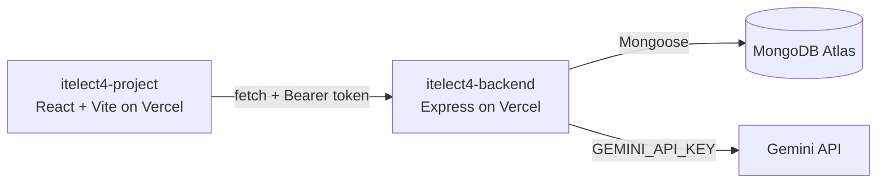

# itelect4-backend

[](https://github.com/tobskie/itelect4-backend/actions/workflows/ci.yml)

The REST API behind the Peer Tutoring Platform: Express 5 in TypeScript, MongoDB Atlas through Mongoose, JWT authentication, and an AI route utilizing Gemini.

- **Live API:** https://<your-backend-subdomain>.vercel.app/api/health
- **Frontend repo:** https://github.com/tobskie/itelect4-project

## Architecture



## Local Development

```bash
# 1. Install dependencies
npm install

# 2. Configure environment (.env)
# Copy .env.example to .env and fill in MONGODB_URI, JWT_SECRET, GEMINI_API_KEY

# 3. Seed database
npm run seed

# 4. Start local server
npm run dev

# 5. Run tests & typecheck
npm test
npm run typecheck
```
